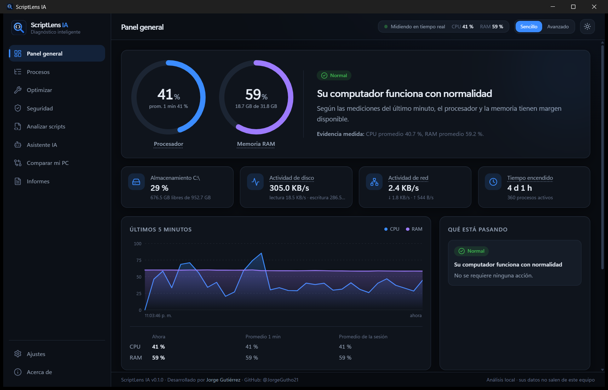
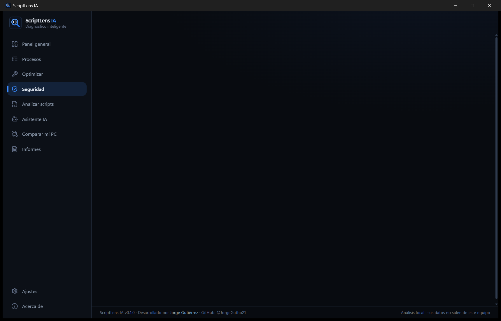
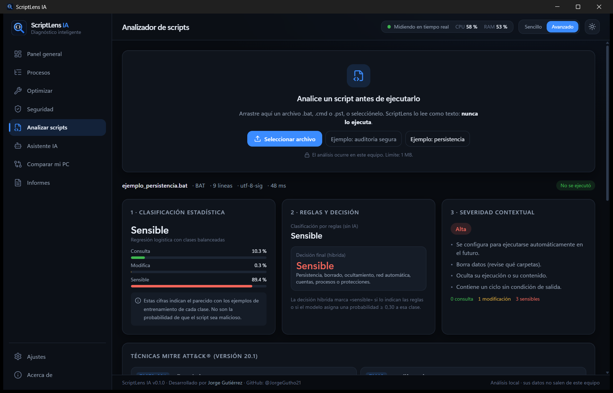
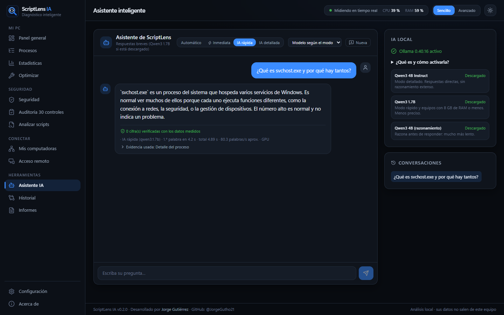

<p align="center">
  
</p>

<h1 align="center">ScriptLens IA</h1>

<p align="center">
  Sistema inteligente de diagnóstico, seguridad, auditoría y optimización supervisada de Windows.<br>
  <strong>Desarrollado por Jorge Gutiérrez</strong> · GitHub: <a href="https://github.com/JorgeGutho21">@JorgeGutho21</a><br>
  Universidad Popular del Cesar · Ingeniería de Sistemas · ExpoSoftware 2026-II
</p>

<p align="center">
  <a href="https://github.com/JorgeGutho21/ScriptLens/releases">Descargas (Releases)</a> ·
  <a href="docs/instalacion/INSTALACION.md">Guía de instalación</a> ·
  <a href="docs/PRIVACIDAD.md">Privacidad</a> ·
  <a href="docs/ESTADO_DESARROLLO.md">Estado del desarrollo</a>
</p>



## Qué es

ScriptLens IA explica, en lenguaje sencillo, por qué un computador con Windows va lento, qué programas están funcionando, qué arranca con el sistema y si algo merece revisión. Analiza scripts BAT, CMD y PowerShell **sin ejecutarlos** y responde preguntas con un asistente de inteligencia artificial que funciona **dentro del propio equipo**. Ninguna acción que modifique el sistema se realiza sin la confirmación explícita del usuario.

## Características

| Módulo | Qué hace |
|---|---|
| Panel general | CPU total y por núcleo, RAM, disco, red y tiempo encendido medidos en tiempo real; diagnóstico de consumo **sostenido** (promedio de 1 minuto), no de picos |
| Procesos | Tabla con búsqueda y filtros, árbol padre-hijo, ruta, firma digital (Authenticode), editor, conexiones y respuestas a «¿qué hace?, ¿puedo cerrarlo?, ¿es sospechoso?» separando datos comprobados de conclusiones estimadas |
| Optimizar | Recomendaciones basadas en mediciones, solicitud de cierre o finalización de procesos no protegidos, limpieza de temporales con vista previa, desinstaladores oficiales y registro de acciones con mediciones antes/después |
| Seguridad | Microsoft Defender, firewall, inicio automático (con activación/desactivación reversible), tareas programadas, servicios y eventos; hallazgos con ocho puntos (qué, dónde, por qué, evidencia, qué falta, consecuencias, qué hacer, qué evitar) |
| Analizar scripts | Catálogo de 43 reglas (24 del proyecto académico original), técnicas MITRE ATT&CK 20.1, desofuscación estática, flujo, explicación línea por línea y regresión logística balanceada sobre TF-IDF de n-gramas de caracteres |
| Asistente IA | Ollama + Qwen3 4B Instruct, herramientas internas de solo lectura, verificación cifra por cifra y respuestas sin IA cuando Ollama no está instalado |
| Comparar mi PC | Guarda diagnósticos en SQLite y compara dos momentos sin atribuir causas sin evidencia |
| Informes | PDF y HTML con métricas, evidencias, recomendaciones, acciones y limitaciones, con marca de agua discreta |
| Experiencia | Modo sencillo y avanzado, modo claro y oscuro, tamaño de texto, reducción de animaciones, glosario contextual, asistente de primera ejecución y un elemento 3D discreto |

<p>
  
  
  
  
</p>

Todas las capturas de [docs/capturas](docs/capturas) se tomaron de la versión instalada con el instalador de este repositorio.

## Tecnologías

Tauri 2 · React 19 · TypeScript · Tailwind CSS 4 · Three.js · Python 3.12 · FastAPI · psutil · API nativa de Windows (`NtQuerySystemInformation`) · SQLite · scikit-learn · reportlab · Ollama · Qwen3 · PyInstaller · NSIS · pytest · GitHub Actions.

Arquitectura: [docs/arquitectura/arquitectura.md](docs/arquitectura/arquitectura.md) · Sistema de diseño: [sistema_diseno.md](docs/arquitectura/sistema_diseno.md) · Investigación de repositorios: [investigacion_repositorios.md](docs/arquitectura/investigacion_repositorios.md) · Evaluación del clasificador: [evaluacion_clasificador.md](docs/pruebas/evaluacion_clasificador.md).

## Requisitos

- Windows 10 (versión 1809 o posterior) u 11, 64 bits.
- 4 GB de RAM para la aplicación; 8 GB o más para usar el asistente con IA local.
- ≈ 200 MB de disco para la aplicación; ≈ 2,5 GB adicionales para el modelo de IA (opcional).
- Microsoft Edge WebView2 (incluido en Windows 11 y en Windows 10 actualizado).

## Instalación

La guía completa, con capturas y errores habituales, está en [docs/instalacion/INSTALACION.md](docs/instalacion/INSTALACION.md).

### Método A — Instalador gráfico (recomendado)

1. Abra [Releases](https://github.com/JorgeGutho21/ScriptLens/releases) y descargue `ScriptLens IA_0.1.0_x64-setup.exe` y su archivo `.sha256`.
2. Haga doble clic en el instalador. Si Windows SmartScreen avisa «Windows protegió su PC», pulse **Más información → Ejecutar de todos modos** (el instalador no tiene firma comercial; verifique antes el hash).
3. Abra **ScriptLens IA** desde el menú Inicio. No requiere permisos de administrador.

> Mientras no exista una versión publicada, el instalador puede construirse con el Método C (`scripts\construir_instalador.ps1`).

### Método B — PowerShell con verificación de integridad

En **PowerShell** (no requiere administrador), dentro de la carpeta donde descargó los dos archivos:

```powershell
$archivo = "ScriptLens IA_0.1.0_x64-setup.exe"
$esperado = (Get-Content "$archivo.sha256").Split(" ")[0]
$real = (Get-FileHash $archivo -Algorithm SHA256).Hash
if ($real -eq $esperado) { Start-Process ".\$archivo" } else { Write-Error "El hash no coincide: no instale este archivo." }
```

No existe todavía un paquete oficial de WinGet para ScriptLens IA.

### Método C — Desarrolladores (código fuente)

Requisitos: Git, Python 3.12, Node.js 20+, Rust estable y Visual Studio Build Tools con «Desarrollo de escritorio con C++». En **PowerShell**:

```powershell
git clone https://github.com/JorgeGutho21/ScriptLens.git
cd ScriptLens
py -3.12 -m venv .venv
.\.venv\Scripts\pip install -r backend\requirements-dev.txt pyinstaller
npm install
npm --prefix frontend install
npm run dev                          # aplicación de escritorio en modo desarrollo
.\.venv\Scripts\python -m pytest     # pruebas del motor
.\scripts\construir_instalador.ps1   # instalador NSIS + SHA-256
```

Si Rust informa `link.exe not found`, ejecute antes `. .\scripts\msvc-env.ps1` en la misma ventana.

## Configurar la IA local (opcional)

1. Instale Ollama desde [ollama.com/download](https://ollama.com/download) y ábralo.
2. En ScriptLens, abra **Asistente IA** y pulse **Descargar** junto a «Qwen3 4B Instruct» (≈ 2,5 GB; requiere su confirmación). También puede hacerlo en PowerShell: `ollama pull qwen3:4b-instruct`.
3. El indicador debe mostrar «Ollama activo». Sin Ollama, el asistente responde con plantillas basadas en los mismos datos medidos.

Se usa la variante *Instruct* porque la etiqueta `qwen3:4b` corresponde a un modelo que razona antes de responder: en el equipo de desarrollo tardó 256 s en una respuesta frente a 10–60 s de la variante Instruct.

## Guía rápida de uso

1. **Panel general:** observe CPU y RAM; el recuadro «Qué está pasando» resume la situación.
2. **Procesos:** pulse un programa para saber qué hace y si puede cerrarlo.
3. **Seguridad → Revisar ahora:** revise los hallazgos que «requieren revisión».
4. **Analizar scripts:** arrastre un `.bat`, `.cmd` o `.ps1` antes de ejecutarlo.
5. **Asistente IA:** pregunte, por ejemplo, «¿Por qué mi computador está lento?».
6. **Comparar mi PC:** guarde un diagnóstico antes de un cambio y compárelo después.
7. **Informes:** genere un PDF o HTML para conservar o compartir el diagnóstico.

El manual completo para principiantes está en `docs/manual_usuario/Manual_Usuario_ScriptLens_IA.pdf`.

## Preguntas frecuentes

- **¿ScriptLens es un antivirus?** No. Solo Microsoft Defender puede producir el estado «Amenaza detectada»; ScriptLens señala aspectos que conviene revisar.
- **¿Envía mis datos a Internet?** No. El análisis y la IA son locales. La única conexión opcional es «Buscar actualizaciones», que consulta GitHub sin enviar datos del equipo.
- **¿Puede dañar Windows?** No finaliza procesos críticos, servicios ni componentes de seguridad, no desactiva protecciones y toda acción requiere confirmación.
- **¿Por qué Windows advierte al instalar?** El instalador no tiene firma de código comercial. Verifique el SHA-256 publicado.

## Privacidad

Consulte [docs/PRIVACIDAD.md](docs/PRIVACIDAD.md) y [SECURITY.md](SECURITY.md).

## Licencia y atribuciones

MIT © 2026 Jorge Gutiérrez. Componentes de terceros y referencias conceptuales en [THIRD_PARTY_NOTICES.md](THIRD_PARTY_NOTICES.md). ATT&CK® es una marca registrada de The MITRE Corporation.
