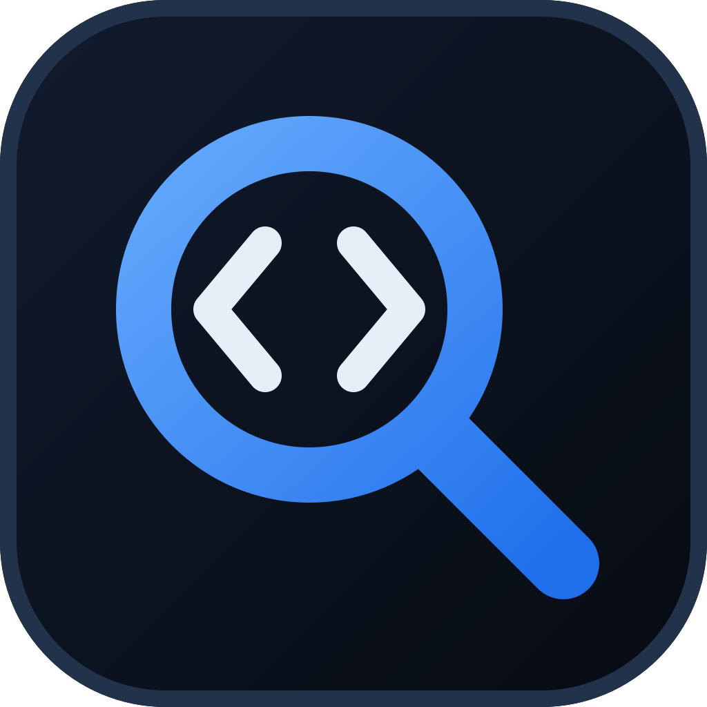
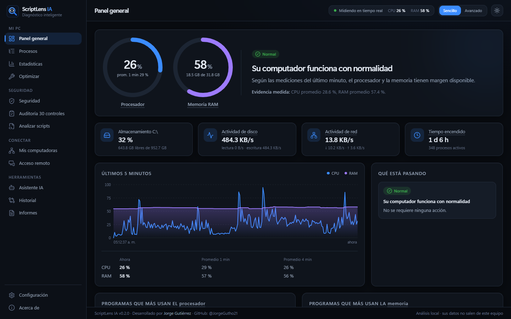
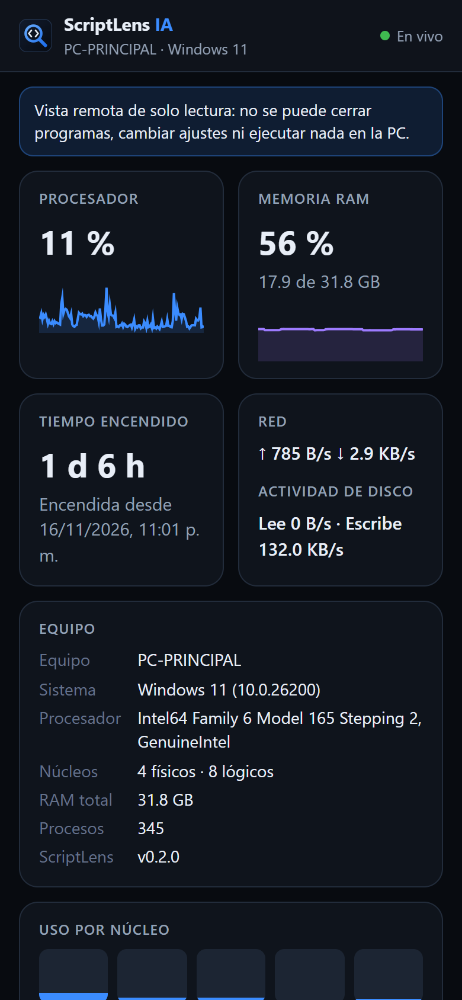
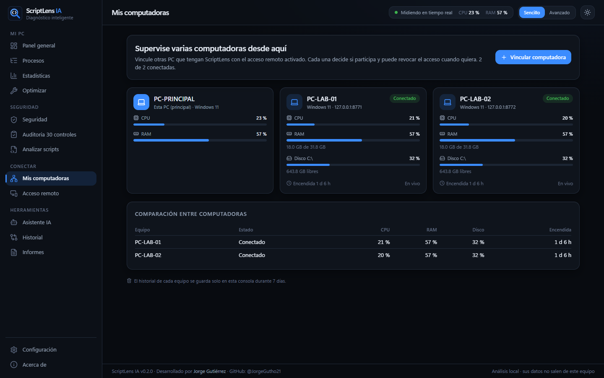
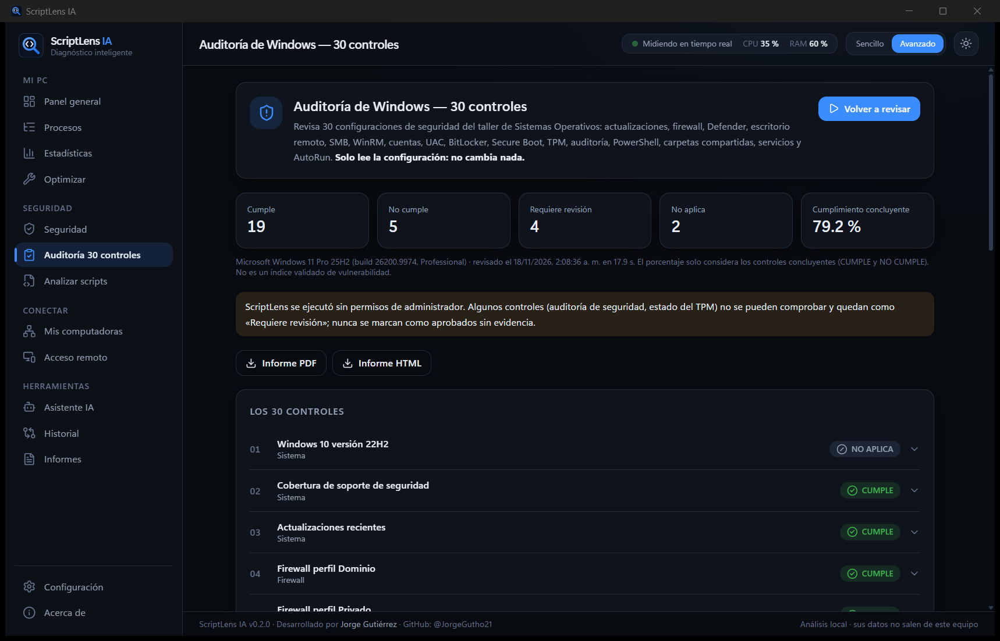
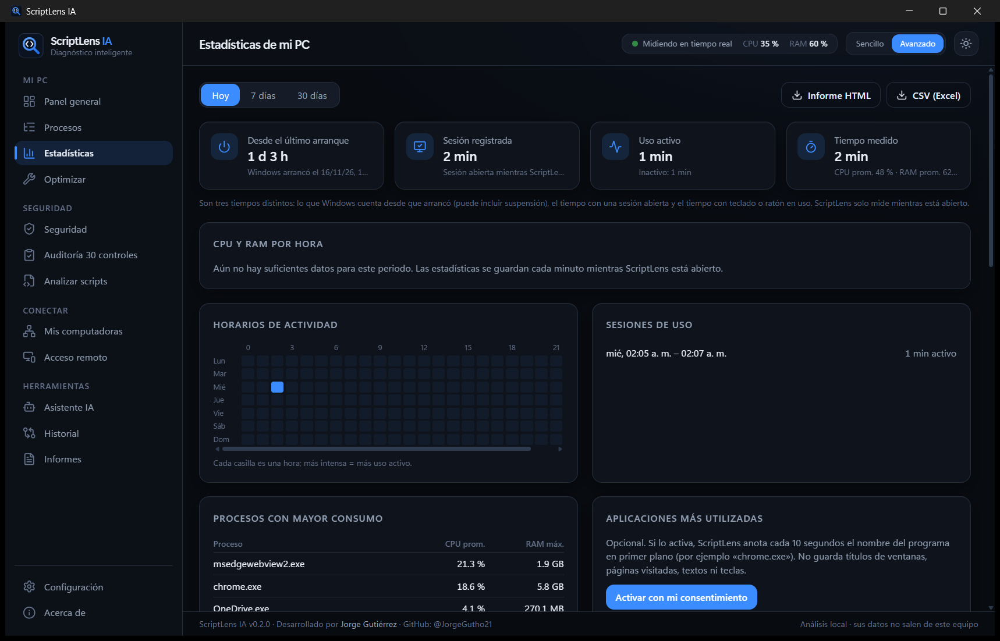
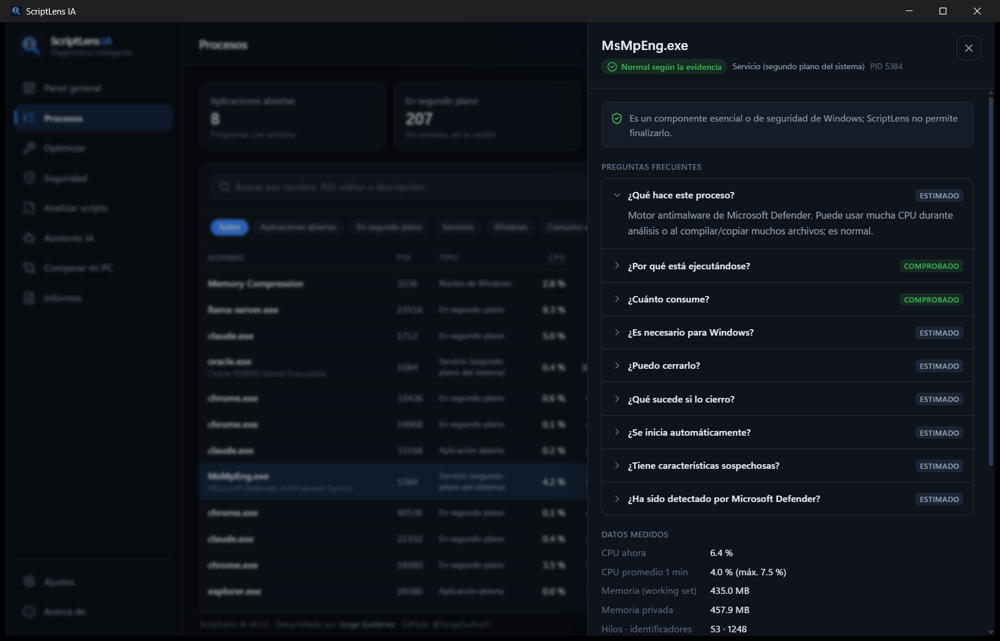
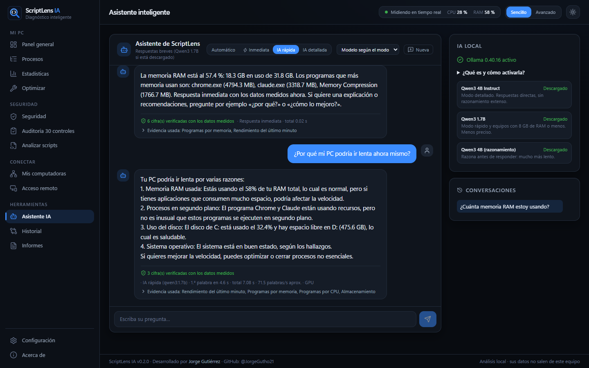

<p align="center">
  
</p>

<h1 align="center">ScriptLens IA</h1>

<p align="center">
  Sistema inteligente de diagnóstico, seguridad, auditoría y optimización supervisada de Windows.<br>
  <strong>Desarrollado por Jorge Gutiérrez</strong> · GitHub: <a href="https://github.com/JorgeGutho21">@JorgeGutho21</a><br>
  Docente: Oswaldo Rueda Carreño<br>
  Universidad Popular del Cesar · Ingeniería de Sistemas · ExpoSoftware 2026-II
</p>

<p align="center">
  <a href="https://jorgegutho21.github.io/ScriptLens/"></a>
  <a href="https://github.com/JorgeGutho21/ScriptLens/releases/download/v0.2.0/ScriptLens-IA_0.2.0_x64-setup.exe"></a>
  <a href="https://jorgegutho21.github.io/ScriptLens/#instalacion"></a>
</p>

<p align="center">Windows 10 y 11 de 64 bits · 52 MB · sin permisos de administrador · SHA-256 <code>FAE79D9D…813E2C</code></p>



## Novedades de la versión 0.2.0

- **Acceso remoto de solo lectura:** mira tu PC desde el celular u otra laptop de la misma red, con código temporal, aprobación en la PC y revocación.
- **Mis computadoras:** una PC con ScriptLens supervisa a otras que la autorizaron: estado, CPU, RAM, disco, historial de 24 horas y comparación.
- **Estadísticas de mi PC:** tiempo encendido, sesión y uso activo; consumo por hora, día y semana; informes HTML y CSV.
- **Auditoría de 30 controles:** revisión de solo lectura de la configuración de seguridad de Windows, con evidencia y recomendación.
- **Asistente más rápido:** respuestas inmediatas con los datos medidos y modos de IA rápida y detallada ([mediciones](docs/pruebas/asistente/RESULTADOS.md)).

<p>
  
  
</p>

Las capturas de acceso remoto y de varias computadoras se tomaron en un solo equipo (dirección `127.0.0.1`, instancias aisladas de ScriptLens y vista del celular en un navegador con tamaño de teléfono). La prueba con un celular y dos computadoras físicas está pendiente; ver [ESTADO_v0.2.md](docs/desarrollo/ESTADO_v0.2.md).

## Contenido

[Novedades](#novedades-de-la-versión-020) · [Qué es](#qué-es) · [Problema y objetivos](#problema-que-resuelve-y-objetivos) · [Funcionalidades](#funcionalidades) · [Requisitos](#requisitos-mínimos-y-sistemas-compatibles) · [Descarga e instalación](#descarga-e-instalación) · [Asistente de IA](#configurar-el-asistente-de-ia-opcional) · [Primer análisis](#primer-análisis) · [Acceso remoto y varias PC](#ver-la-pc-desde-el-celular-y-supervisar-varias-computadoras) · [Módulos](#qué-hace-cada-módulo) · [Preguntas al asistente](#ejemplos-de-preguntas-al-asistente) · [Acciones supervisadas](#acciones-supervisadas) · [Informes](#exportar-informes) · [Actualizaciones](#actualizaciones) · [Solución de errores](#solución-de-errores) · [Desinstalación](#desinstalación) · [Privacidad](#privacidad) · [Códigos QR](#códigos-qr-para-la-exposición) · [Licencias](#licencias) · [Soporte](#soporte)

## Qué es

ScriptLens IA es una aplicación de escritorio para Windows que explica, en lenguaje sencillo, por qué un computador va lento, qué programas están funcionando, qué arranca con el sistema y si algo merece revisión. Analiza scripts BAT, CMD y PowerShell **sin ejecutarlos** y responde preguntas con un asistente de inteligencia artificial que funciona **dentro del propio equipo**. Ninguna acción que modifique el sistema se realiza sin la confirmación explícita del usuario, y la IA no puede ejecutar acciones.

## Problema que resuelve y objetivos

Las herramientas incluidas en Windows muestran cifras (porcentajes, identificadores, nombres de procesos) pero no explican qué significan ni qué conviene hacer. Al mismo tiempo, es habitual ejecutar scripts recibidos de compañeros o descargados de Internet sin leerlos. ScriptLens une medición real, explicación y supervisión humana.

**Objetivo general:** desarrollar una aplicación de escritorio para Windows que diagnostique el rendimiento y la seguridad del equipo y analice scripts de forma estática, con explicaciones comprensibles para personas sin formación técnica y acciones siempre supervisadas.

**Objetivos específicos:**

1. Medir en tiempo real CPU, memoria, disco, red y procesos, distinguiendo consumo sostenido de picos.
2. Revisar en modo de solo lectura Defender, firewall, inicio automático, tareas programadas, servicios y eventos.
3. Clasificar scripts con reglas asociadas a MITRE ATT&CK y una regresión logística balanceada, evaluada con datos no vistos.
4. Responder preguntas con un modelo de lenguaje local cuyas cifras se comprueban contra los datos medidos.
5. Ejecutar solo acciones reversibles o confirmadas, registradas con mediciones antes y después.

## Funcionalidades

| Módulo | Qué hace |
|---|---|
| Panel general | CPU total y por núcleo, RAM, disco, red y tiempo encendido medidos en tiempo real; diagnóstico de consumo **sostenido** (promedio de 1 minuto), no de picos |
| Procesos | Tabla con búsqueda y filtros, árbol padre-hijo, ruta, firma digital (Authenticode), editor, conexiones y respuestas a «¿qué hace?, ¿puedo cerrarlo?, ¿es sospechoso?» separando datos comprobados de conclusiones estimadas |
| Optimizar | Recomendaciones basadas en mediciones, cierre o finalización supervisados de procesos no protegidos, limpieza de temporales con vista previa, desinstaladores oficiales y registro de acciones con mediciones antes/después |
| Seguridad | Microsoft Defender, firewall, inicio automático (activación/desactivación reversible), tareas programadas, servicios y eventos; cada hallazgo explica qué, dónde, por qué, evidencia, qué falta, consecuencias, qué hacer y qué evitar |
| Analizar scripts | 43 reglas (24 del proyecto académico original), técnicas MITRE ATT&CK 20.1, desofuscación estática, flujo, explicación línea por línea y regresión logística balanceada sobre TF-IDF de n-gramas de caracteres |
| Estadísticas de mi PC | Historial por hora, día y semana de CPU, RAM, disco y red; tiempo desde el arranque, sesión y uso activo por separado; sesiones, horarios de actividad, procesos y (con consentimiento) aplicaciones más usadas; alertas por consumo sostenido; informes HTML y CSV |
| Auditoría 30 controles | Los 30 controles de seguridad de Windows del taller (actualizaciones, firewall, Defender, RDP, SMB, WinRM, cuentas, UAC, BitLocker, Secure Boot, TPM, auditoría, PowerShell, recursos compartidos, servicios, AutoRun) con evidencia, explicación y recomendación; solo lectura; informes PDF y HTML |
| Acceso remoto | Ver esta PC desde un celular u otra laptop de la misma red, por HTTPS y en modo de **solo lectura**, con código temporal, aprobación en la PC y revocación |
| Mis computadoras | Consola para supervisar varias PC con ScriptLens: estado conectado/desconectado, última lectura, CPU, RAM, disco, alertas, historial y comparación |
| Asistente IA | Respuesta inmediata con datos medidos para preguntas simples, modo IA rápida (Qwen3 1.7B) e IA detallada (Qwen3 4B Instruct) con Ollama, cancelación, verificación cifra por cifra y respuestas sin IA cuando Ollama no está instalado |
| Comparar mi PC | Guarda diagnósticos en SQLite y compara dos momentos sin atribuir causas sin evidencia |
| Informes | PDF y HTML con métricas, evidencias, recomendaciones, acciones y limitaciones |
| Experiencia | Modo sencillo y avanzado, tema claro y oscuro, tamaño de texto, reducción de animaciones, glosario contextual y asistente de primera ejecución |

<p>
  
  
  
  
  
  
</p>

Todas las capturas de [docs/capturas](docs/capturas) son reales y muestran datos del equipo de pruebas, sin rutas ni nombres personales. Las numeradas del 23 al 34, junto con 09, 12, 15, 17 y 19, son de la versión 0.2.0 y se obtuvieron con [scripts/demo_capturas.py](scripts/demo_capturas.py) y [scripts/capturar_navegador.py](scripts/capturar_navegador.py), que ejecutan instancias aisladas solo en `127.0.0.1`.

## Requisitos mínimos y sistemas compatibles

| | Mínimo | Recomendado para la IA local |
|---|---|---|
| Sistema operativo | Windows 10 (1809 o posterior) u 11, **64 bits** | Windows 11 de 64 bits actualizado |
| Memoria RAM | 4 GB | 8 GB o más |
| Disco libre | 200 MB | 3 GB (incluye el modelo de IA) |
| Componentes | Microsoft Edge WebView2 (incluido en Windows 11 y en Windows 10 actualizado) | Ollama |
| Permisos | Cuenta de usuario estándar; no requiere administrador | — |

**No compatible:** Windows de 32 bits, Windows 7/8, macOS y Linux. La versión empaquetada **no** necesita Python, Node.js, Rust ni Visual Studio. Los entornos realmente probados están en [docs/pruebas/compatibilidad.md](docs/pruebas/compatibilidad.md).

## Descarga e instalación

Sigue la [guía de instalación en la página oficial](https://jorgegutho21.github.io/ScriptLens/#instalacion). La guía también está disponible en [Guia_Instalacion_ScriptLens_IA.pdf](docs/instalacion/Guia_Instalacion_ScriptLens_IA.pdf) (versión editable: [.docx](docs/instalacion/Guia_Instalacion_ScriptLens_IA.docx); versión Markdown: [INSTALACION.md](docs/instalacion/INSTALACION.md)).

Archivos de cada versión publicada en [Releases](https://github.com/JorgeGutho21/ScriptLens/releases):

| Archivo | Para qué sirve |
|---|---|
| `ScriptLens-IA_0.2.0_x64-setup.exe` | Instalador para Windows de 64 bits |
| `ScriptLens-IA_0.2.0_x64-setup.exe.sha256` | Huella SHA-256 para comprobar que el archivo descargado es el original |

### Método A — Instalador gráfico (recomendado)

1. Abra la [guía de instalación](https://jorgegutho21.github.io/ScriptLens/#instalacion) o la [release v0.2.0](https://github.com/JorgeGutho21/ScriptLens/releases/tag/v0.2.0) y descargue los dos archivos de la tabla anterior.
2. Compruebe la huella SHA-256 (Método B, paso 2). Si no coincide, **no abra el archivo**.
3. Haga doble clic en el instalador. El instalador no tiene firma de código comercial, por lo que Windows SmartScreen puede mostrar «Windows protegió su PC». Continúe solo si descargó el archivo de la página oficial y la huella coincide: pulse **Más información** → **Ejecutar de todas formas**. Si tiene dudas, no continúe.
4. Siga el asistente (**Siguiente** → **Instalar** → **Finalizar**). La instalación es solo para su usuario y no pide permisos de administrador.
5. Abra **ScriptLens IA** desde el menú Inicio.

### Método B — PowerShell con verificación de integridad

Abra **PowerShell** (menú Inicio → escriba «PowerShell»; no hace falta «Ejecutar como administrador») y copie estos comandos uno por uno:

```powershell
# 1. Descargar el instalador y su huella a la carpeta Descargas
cd $HOME\Downloads
$base = "https://github.com/JorgeGutho21/ScriptLens/releases/download/v0.2.0"
$f = "ScriptLens-IA_0.2.0_x64-setup.exe"
Invoke-WebRequest "$base/$f" -OutFile $f
Invoke-WebRequest "$base/$f.sha256" -OutFile "$f.sha256"
```

```powershell
# 2. Comprobar la huella: debe responder "Coincide"
$f = "ScriptLens-IA_0.2.0_x64-setup.exe"
$esperado = (Get-Content "$f.sha256").Split(" ")[0]
$real = (Get-FileHash $f -Algorithm SHA256).Hash
if ($real -eq $esperado) { "Coincide" } else { "NO coincide: no instale" }
```

```powershell
# 3. Abrir el instalador (solo si respondió "Coincide")
Start-Process ".\ScriptLens-IA_0.2.0_x64-setup.exe"
```

Instalación silenciosa para su usuario (sin ventanas): `Start-Process ".\ScriptLens-IA_0.2.0_x64-setup.exe" -ArgumentList "/S" -Wait`.

### Método C — Símbolo del sistema (CMD)

En **Símbolo del sistema** (menú Inicio → escriba «cmd»):

```bat
cd %USERPROFILE%\Downloads
set BASE=https://github.com/JorgeGutho21/ScriptLens/releases/download/v0.2.0
set F=ScriptLens-IA_0.2.0_x64-setup.exe
curl -L -O %BASE%/%F%
curl -L -O %BASE%/%F%.sha256
certutil -hashfile %F% SHA256
type %F%.sha256
```

Compare a simple vista la huella que muestra `certutil` con la del archivo `.sha256` (deben ser iguales, sin importar mayúsculas). Si coinciden, ejecute `start ScriptLens-IA_0.2.0_x64-setup.exe`.

### Método D — Desarrolladores (código fuente)

Solo para quien quiera modificar o compilar ScriptLens. Requisitos: Git, Python 3.12, Node.js 20+, Rust estable y Visual Studio Build Tools con «Desarrollo de escritorio con C++». En **PowerShell**:

```powershell
git clone https://github.com/JorgeGutho21/ScriptLens.git
cd ScriptLens
py -3.12 -m venv .venv
.\.venv\Scripts\pip install -r backend\requirements-dev.txt pyinstaller
npm install
npm --prefix frontend install
npm run dev                          # aplicación de escritorio en modo desarrollo
.\.venv\Scripts\python -m pytest     # pruebas del motor
.\scripts\construir_instalador.ps1   # instalador NSIS + SHA-256
```

Si Rust informa `link.exe not found`, ejecute antes `. .\scripts\msvc-env.ps1` en la misma ventana.

## Configurar el asistente de IA (opcional)

Todas las funciones, salvo la redacción con IA, funcionan sin instalar nada más.

1. Instale Ollama desde [ollama.com/download](https://ollama.com/download) y ábralo.
2. En ScriptLens, abra **Asistente IA** y pulse **Descargar** junto a «Qwen3 4B Instruct» (≈ 2,5 GB; pide su confirmación). También puede hacerlo en PowerShell: `ollama pull qwen3:4b-instruct`.
3. El indicador debe mostrar «Ollama activo». Sin Ollama, el asistente responde con plantillas basadas en los mismos datos medidos.

Se usa la variante *Instruct* porque `qwen3:4b` razona antes de responder: en el equipo de pruebas tardó 256 s en una respuesta, frente a 10–60 s de la variante Instruct. En equipos con 8 GB de RAM o menos puede elegir `qwen3:1.7b`.

## Primer análisis

1. Al abrir ScriptLens por primera vez, un asistente de bienvenida explica cada sección y permite elegir el modo sencillo o avanzado.
2. Espere un minuto en el **Panel general**: ScriptLens necesita ese tiempo para distinguir un consumo sostenido de un pico momentáneo.
3. Abra **Seguridad** y pulse **Revisar ahora** (tarda entre 5 y 30 s).
4. Lea el recuadro «Qué está pasando» del panel y los hallazgos marcados «Requiere revisión».

## Ver la PC desde el celular y supervisar varias computadoras

Guía completa paso a paso: [Conectar y supervisar computadoras con ScriptLens IA](docs/guias/Conectar_y_supervisar_computadoras.md).

1. En la PC: **Conectar → Acceso remoto → Activar acceso remoto**. Aparecen la dirección (por ejemplo `https://192.168.1.25:8765/`), un código de 6 cifras y la huella del certificado.
2. Si Windows pregunta, permita el acceso solo en **Redes privadas**.
3. En el celular, conectado a la **misma red** (o al hotspot del celular), abra la dirección, acepte el aviso del certificado tras comparar la huella y escriba el código.
4. En la PC pulse **Autorizar** si la frase de verificación coincide. El celular verá CPU, RAM, discos, red, procesos y hallazgos en vivo, **sin poder cambiar nada**.
5. Para supervisar otra PC: active el acceso remoto en ella y, en la PC principal, use **Conectar → Mis computadoras → Vincular computadora** con su IP y su código.
6. **Desactivar y desconectar todo** revoca de inmediato a todos los dispositivos.
7. **Invitar por correo** (en desarrollo, aún sin versión publicada): envía a un correo concreto un enlace de un solo uso; la persona confirma su correo al abrirlo y solo ve lo que usted marque. En modo de prueba el correo se guarda como archivo `.eml` en la PC. Detalles en la [guía](docs/guias/Conectar_y_supervisar_computadoras.md#invitar-a-una-persona-por-correo).

Muchas redes universitarias aíslan a los dispositivos entre sí; en ese caso use el punto de acceso (hotspot) de un celular.

## Qué hace cada módulo

- **Panel general:** los anillos muestran CPU (cuánto trabaja el procesador) y RAM (cuánta memoria de trabajo está ocupada). El diagnóstico usa el promedio del último minuto.
- **Procesos:** cada programa en ejecución con su tipo (aplicación abierta, segundo plano, servicio, Windows), consumo, editor y firma. Al pulsar uno se explica qué hace y si es seguro cerrarlo. El árbol muestra qué programa inició a cuál.
- **Optimizar:** recomendaciones basadas en las mediciones, limpieza de temporales con vista previa y desinstalación mediante el desinstalador oficial de cada programa.
- **Seguridad:** estado de Defender y del firewall, programas de inicio, tareas programadas, servicios de terceros y eventos recientes. Solo Microsoft Defender puede declarar «Amenaza detectada».
- **Analizar scripts:** arrastre un `.bat`, `.cmd` o `.ps1`; ScriptLens lo lee **sin ejecutarlo**, decide «Consulta», «Modifica» o «Sensible» y explica cada línea.
- **Asistente IA:** preguntas en lenguaje natural respondidas con datos medidos.
- **Comparar mi PC:** guarde un diagnóstico, haga un cambio y compare.
- **Informes:** PDF o HTML del estado del equipo.

## Ejemplos de preguntas al asistente

«¿Qué proceso consume más CPU?» · «¿Qué aplicación consume más RAM?» · «¿Por qué está lento el computador?» · «¿Qué tareas se ejecutan en segundo plano?» · «¿Qué programas puedo cerrar?» · «¿Qué proceso requiere investigación?» · «¿Qué significa esta alerta?» · «¿Tengo amenazas registradas?» · «¿Qué programas se inician con Windows?» · «¿Qué cambió desde el último diagnóstico?» · «¿Qué es svchost.exe?»

Cada respuesta muestra la evidencia usada y si sus cifras se verificaron. El asistente no puede cerrar programas, borrar archivos ni cambiar configuraciones.

## Acciones supervisadas

Cerrar o finalizar un programa, activar o desactivar un programa de inicio, limpiar temporales o abrir un desinstalador siempre muestra primero qué se hará, con **Cancelar** seleccionado por defecto. ScriptLens:

- No finaliza procesos críticos de Windows, servicios ni componentes de seguridad.
- Solo limpia archivos de más de 7 días dentro de la carpeta temporal de su usuario; rechaza rutas vacías, relativas, personales o del sistema y no sigue enlaces ni uniones.
- No desactiva Defender ni el firewall, y no modifica permisos del sistema.
- Registra cada acción con mediciones antes y después (**Optimizar → Registro de acciones**).

## Exportar informes

En **Informes**, pulse **Crear PDF** o **Crear HTML**. Los archivos se guardan en `Documentos\ScriptLens IA\Informes` e incluyen métricas, hallazgos, acciones realizadas y limitaciones.

## Actualizaciones

En **Acerca de → Buscar actualizaciones**, ScriptLens consulta GitHub Releases solo cuando usted lo pide y nunca instala nada por sí misma. Para actualizar, descargue la nueva versión, compruebe su SHA-256 e instálela encima: el historial se conserva.

## Solución de errores

| Síntoma | Qué hacer |
|---|---|
| «Windows protegió su PC» | Es el aviso de SmartScreen para instaladores sin firma comercial. Compruebe la huella SHA-256; si coincide y lo descargó de la página oficial, pulse **Más información → Ejecutar de todas formas** |
| La aplicación se queda en «Iniciando el motor de análisis» más de 1 minuto | El antivirus puede estar examinando el motor la primera vez. Cierre y vuelva a abrir. Si persiste, reinstale |
| Pantalla en blanco | Instale o repare Microsoft Edge WebView2 Runtime desde la página oficial de Microsoft |
| El asistente dice «Ollama no está activo» | Abra Ollama desde el menú Inicio y pulse **Comprobar de nuevo**; o use las respuestas sin IA |
| Las respuestas de la IA tardan mucho | Conecte el cargador, cierre programas pesados o elija `qwen3:1.7b` |
| «Información insuficiente» en el historial de Defender | Windows restringe ese dato a administradores; ScriptLens no eleva privilegios |

Más casos en [docs/instalacion/INSTALACION.md](docs/instalacion/INSTALACION.md).

## Desinstalación

**Configuración → Aplicaciones → Aplicaciones instaladas → ScriptLens IA → Desinstalar.** El historial (`%LOCALAPPDATA%\io.github.jorgegutho21.scriptlens`) se conserva por si reinstala, salvo que marque en el desinstalador la casilla «Eliminar los datos de aplicación»; puede borrarlo antes desde **Ajustes → Privacidad** (botones «Borrar diagnósticos», «Borrar conversaciones» y «Borrar registro de acciones»). Los informes en `Documentos\ScriptLens IA` también se conservan. Ollama y sus modelos se desinstalan aparte.

## Privacidad

El análisis y la IA son locales. ScriptLens no envía listas de procesos, registros ni datos personales a ningún servidor; la única conexión opcional es «Buscar actualizaciones». Detalles en [docs/PRIVACIDAD.md](docs/PRIVACIDAD.md) y [SECURITY.md](SECURITY.md).

## Códigos QR para la exposición

Para el póster de ExpoSoftware 2026-II y las demostraciones. Apuntan directamente a las URL oficiales, sin acortadores, y se verificaron decodificándolos con dos bibliotecas ([resultado](docs/qr/VERIFICACION.md)).

<table>
  <tr>
    <td align="center"><br><strong>Escanea y descubre ScriptLens IA</strong><br><a href="https://jorgegutho21.github.io/ScriptLens/">jorgegutho21.github.io/ScriptLens</a></td>
    <td align="center"><br><strong>Ver código fuente y documentación</strong><br><a href="https://github.com/JorgeGutho21/ScriptLens">github.com/JorgeGutho21/ScriptLens</a></td>
  </tr>
</table>

Archivos PNG y SVG de cada código, la composición para el póster (PNG, SVG y PDF de impresión) e instrucciones de tamaño en [docs/qr](docs/qr/README.md).

## Licencias

MIT © 2026 Jorge Gutiérrez. Componentes de terceros (Tauri, React, three.js, FastAPI, psutil, scikit-learn, reportlab, PyInstaller, datos de MITRE ATT&CK, entre otros) conservan sus licencias, detalladas en [THIRD_PARTY_NOTICES.md](THIRD_PARTY_NOTICES.md). ATT&CK® es una marca registrada de The MITRE Corporation. Ollama y Qwen3 se instalan aparte y se rigen por sus propias licencias.

## Soporte

- Repositorio oficial: [github.com/JorgeGutho21/ScriptLens](https://github.com/JorgeGutho21/ScriptLens)
- Errores y sugerencias: [Issues](https://github.com/JorgeGutho21/ScriptLens/issues)
- Vulnerabilidades: siga [SECURITY.md](SECURITY.md)
- Documentación técnica: [docs/desarrollo/Documentacion_Tecnica_ScriptLens_IA.pdf](docs/desarrollo/Documentacion_Tecnica_ScriptLens_IA.pdf)
