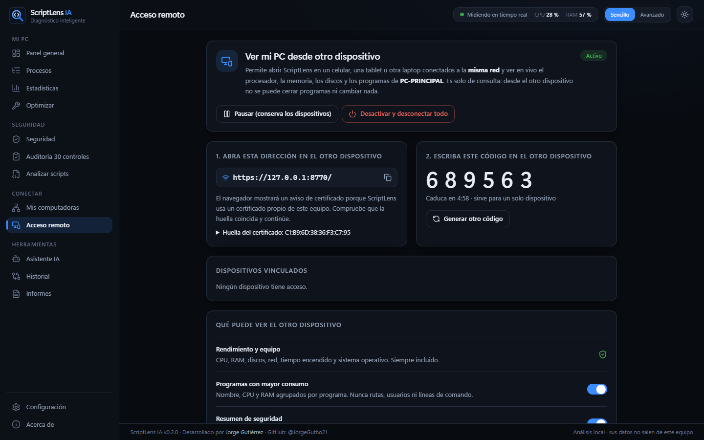
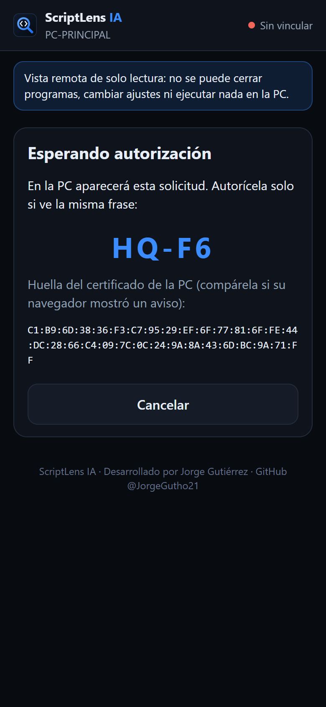
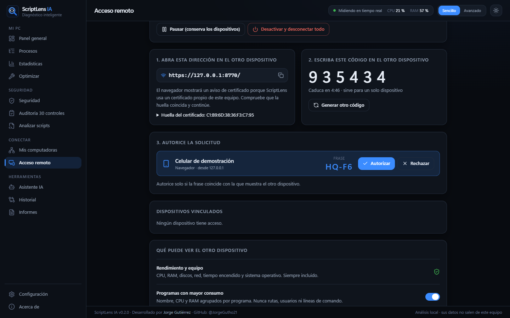
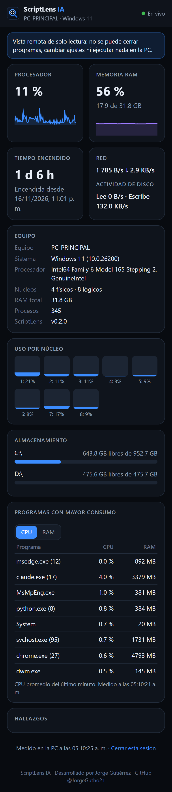
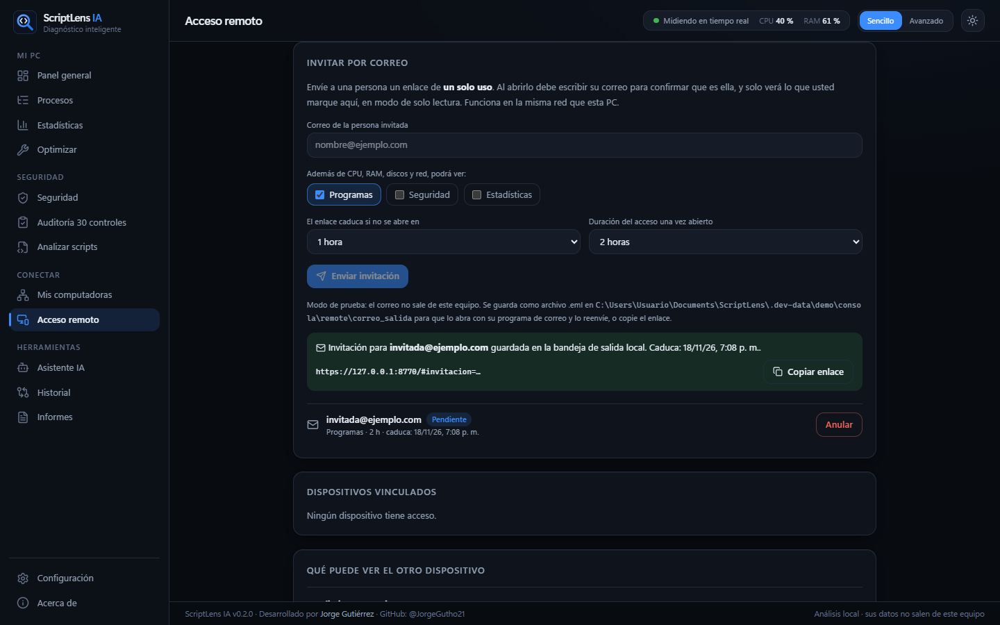
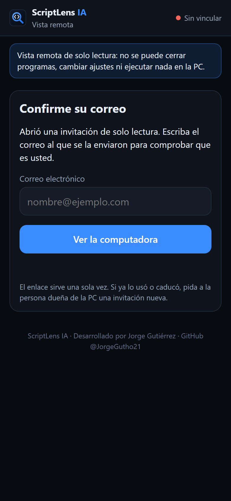
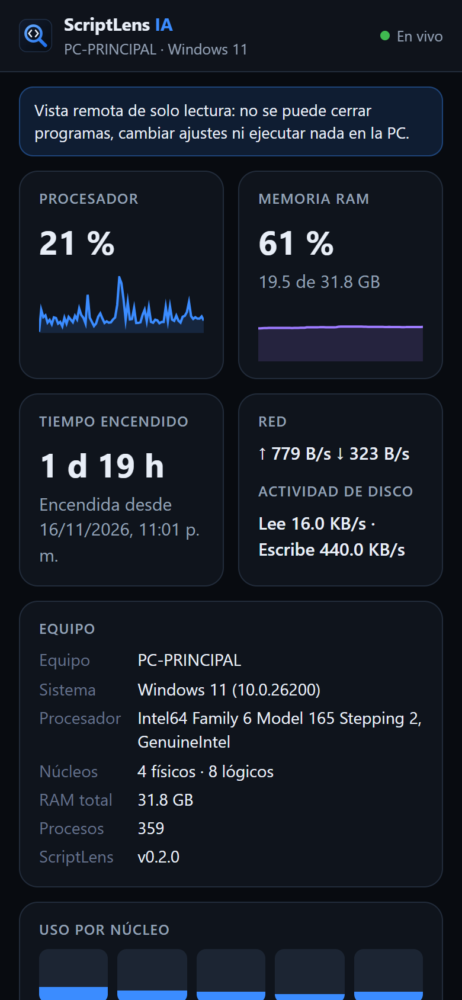
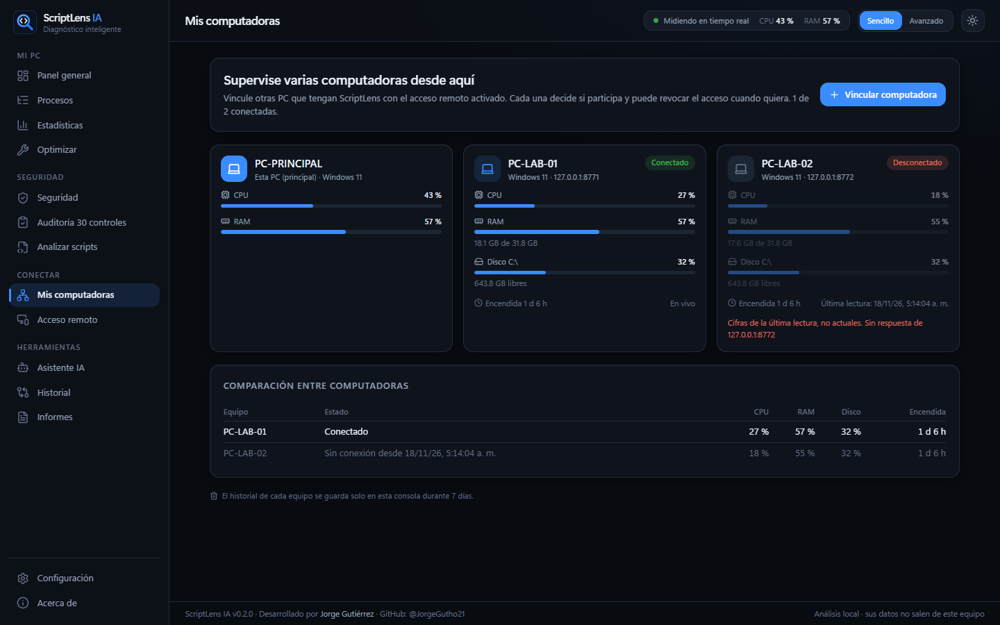
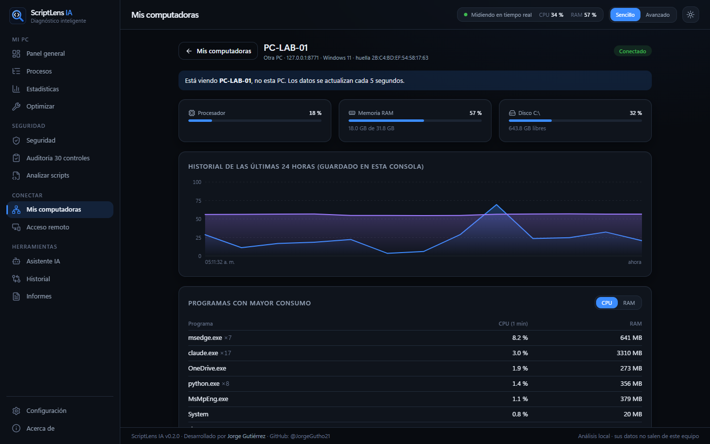

# Conectar y supervisar computadoras con ScriptLens IA

**Guía para principiantes y para la clase de Sistemas Operativos** · ScriptLens IA v0.2.0 ·
Desarrollado por Jorge Gutiérrez (GitHub: @JorgeGutho21) · Universidad Popular del Cesar · ExpoSoftware 2026-II

Esta guía explica cómo ver una PC desde un celular o desde otra laptop y cómo supervisar varias computadoras desde
una sola. Todo funciona dentro de la **misma red local** (WiFi, cable o el punto de acceso de un celular). ScriptLens
no abre puertos en el router, no usa servidores en Internet y no permite controlar la otra PC: **solo consultar**.

---

## Antes de empezar: ideas clave

| Término | Qué significa aquí |
| --- | --- |
| **LAN (red local)** | Los equipos conectados al mismo router WiFi, al mismo cable o al mismo hotspot. |
| **IP local** | La dirección de un equipo dentro de la red, por ejemplo `192.168.1.25`. Cambia según la red. |
| **Puerto** | El «número de puerta» por el que un programa atiende. El acceso remoto de ScriptLens usa el **8765**. |
| **Firewall** | El filtro de Windows que decide qué conexiones entran. Windows pregunta la primera vez que ScriptLens atiende en la red. |
| **Servidor / cliente** | El servidor ofrece datos (la PC con el acceso remoto activo); el cliente los pide (el celular o la consola). |
| **Agente** | Una PC que comparte sus mediciones porque su dueño activó el acceso remoto. |
| **Consola** | La PC con ScriptLens desde la que se supervisan varios agentes («Mis computadoras»). |
| **Autenticación** | Comprobar que quien pide los datos fue autorizado: código temporal de 6 cifras + aprobación en la PC. |
| **Huella del certificado** | Un «código de identidad» de la PC. Si coincide en ambos lados, nadie se está haciendo pasar por ella. |

**Diagnóstico local frente a remoto.** El diagnóstico local (Panel, Procesos, Optimizar…) ve y actúa solo sobre la PC
donde está abierto ScriptLens, y siempre pide confirmación antes de cualquier acción. El acceso remoto es una **vista de
solo lectura**: desde otro dispositivo se puede mirar, pero no cerrar programas, cambiar ajustes ni ejecutar nada.

---

## Parte 1 — Ver una PC desde el celular

1. **Instale ScriptLens en la PC principal.** Descargue el instalador desde
   <https://jorgegutho21.github.io/ScriptLens/>, compruebe su SHA-256 y ejecútelo (no requiere administrador).
2. **Abra «Acceso remoto»** en el menú de la izquierda (grupo *Conectar*).
3. **Pulse «Activar acceso remoto».** ScriptLens comprueba la red y muestra:
   - la **dirección** (por ejemplo `https://192.168.1.25:8765/`),
   - un **código temporal** de 6 cifras (dura 5 minutos y sirve para un solo dispositivo),
   - la **huella del certificado** (por ejemplo `F3:03:1E:CF:…`).

   
4. **Autorice la conexión en Windows.** Si aparece *Alerta de seguridad de Windows*, marque solo
   **Redes privadas** y pulse *Permitir acceso*. ScriptLens no cambia el firewall por su cuenta.
5. **Conecte el celular a la misma red** que la PC (misma WiFi o el hotspot del celular, ver Parte 4).
6. **Abra la dirección en el navegador del celular**, escribiéndola completa con `https://` y el puerto.
   El navegador avisará de que el certificado «no es de confianza»: es normal, porque es un certificado propio de la
   PC. Pulse *Configuración avanzada → Continuar* después de comprobar que la huella coincide.
7. **Complete la vinculación:** escriba el código de 6 cifras y un nombre (por ejemplo «Celular de Ana»).
   En la PC aparecerá la solicitud con una **frase de verificación** (por ejemplo `KS-KU`); si es la misma que ve en
   el celular, pulse **Autorizar**.

    
8. **Consulte CPU y RAM.** El celular muestra en vivo el procesador (total y por núcleo), la memoria, los discos,
   la red, el tiempo encendido y los hallazgos. Arriba se ve «En vivo»; si la PC deja de responder aparece
   «Desconectado» con la hora de la última lectura.

   
9. **Vea los procesos.** La tarjeta «Programas con mayor consumo» se ordena por CPU o RAM. Solo se comparten nombres y
   consumo; nunca rutas, usuarios ni líneas de comando. El propietario puede ocultarla en «Qué puede ver el otro dispositivo».

### Invitar a una persona por correo

En lugar del código de 6 cifras, el propietario puede enviar un **enlace de un solo uso** a un correo concreto.

1. Con el acceso remoto activo, en **Acceso remoto → Invitar por correo**, escriba el correo de la persona, marque qué
   podrá ver además del rendimiento (programas, seguridad, estadísticas), cuánto tarda en caducar el enlace si no se
   abre (15 min a 24 h) y cuánto dura el acceso una vez abierto (1 a 12 h). Pulse **Enviar invitación**.
2. **Modo de prueba (predeterminado):** el correo no sale de la PC; se guarda como archivo `.eml` en la carpeta que
   indica la pantalla. Ábralo con su programa de correo y reenvíelo, o pulse **Copiar enlace**.
3. La persona abre el enlace desde la **misma red**. La página borra el enlace de la barra de direcciones y le pide
   que escriba **su correo**. Si coincide con el de la invitación, entra en la vista de solo lectura con los permisos
   marcados. Un correo distinto, un enlace usado o caducado reciben el mismo mensaje de error, y tres correos
   erróneos bloquean la invitación.
4. En la lista de invitaciones verá si está **Pendiente**, **Usada**, **Caducada**, **Revocada** o **Bloqueada**.
   **Anular** inutiliza un enlace no usado y **Quitar acceso** cierra la sesión de quien ya entró.

 

Para enviar correos reales, defina antes de abrir ScriptLens las variables `SCRIPTLENS_MAIL_MODE=smtp`,
`SCRIPTLENS_SMTP_HOST`, `SCRIPTLENS_SMTP_PORT`, `SCRIPTLENS_SMTP_USER`, `SCRIPTLENS_SMTP_PASSWORD` y
`SCRIPTLENS_SMTP_FROM` (por ejemplo, con una contraseña de aplicación de su proveedor). El envío SMTP real **no se ha
probado** todavía con un servidor externo; solo con un servidor simulado en las pruebas automáticas.

## Parte 2 — Supervisar varias computadoras

10. **Conecte una segunda computadora.** En la segunda PC instale ScriptLens y active el acceso remoto (pasos 2 a 4).
    En la PC que hará de **consola**, abra **Mis computadoras → Vincular computadora**, escriba la IP, el puerto
    (8765) y el código de la segunda PC, y pulse *Vincular*. En la segunda PC autorice la solicitud si la frase coincide.
11. **Selecciónela desde «Mis computadoras».** Cada equipo aparece en su propia tarjeta (CPU, RAM, disco, tiempo
    encendido, alertas y estado *Conectado / Desconectado*). «Esta PC (principal)» siempre aparece aparte para no
    confundirla. Al pulsar una tarjeta se abre su detalle con un aviso de que está viendo **otra PC**.

    
12. **Consulte su historial.** El detalle incluye la gráfica de CPU y RAM de las últimas 24 horas, guardada en la
    consola (una lectura cada ~10 s, durante 7 días), y la tabla de programas con mayor consumo. Con dos o más equipos
    aparece la **comparación entre computadoras**.

    

## Parte 3 — Auditoría, informes y desconexión

13. **Ejecute la auditoría de 30 controles.** En *Seguridad → Auditoría 30 controles* pulse **Ejecutar auditoría**.
    Tarda unos 15 segundos, solo lee la configuración y muestra cada control con su resultado (CUMPLE, NO CUMPLE,
    REQUIERE REVISIÓN o NO APLICA), la evidencia técnica, una explicación sencilla y una recomendación. Sin permisos
    de administrador, algunos controles quedan en «Requiere revisión»: nunca se aprueban sin evidencia.
14. **Genere un informe.** En la auditoría use *Informe PDF* o *Informe HTML*; en *Estadísticas*, *Informe HTML* o
    *CSV (Excel)*; en *Informes*, el diagnóstico general. Todos se guardan en `Documentos\ScriptLens IA\Informes`.
15. **Desconecte y revoque el acceso.** En *Acceso remoto*:
    - **Revocar** junto a un dispositivo le quita el acceso solo a él.
    - **Pausar** apaga el servidor pero conserva los dispositivos vinculados.
    - **Desactivar y desconectar todo** apaga el servidor y revoca **todas** las sesiones: el celular y las consolas
      dejan de ver datos de inmediato y tendrían que vincularse de nuevo.
    En la consola, *Desvincular esta computadora* borra su historial y le pide a la otra PC que olvide la consola.
    Al cerrar ScriptLens el servidor remoto se apaga y al abrirlo de nuevo siempre empieza **apagado**. Los
    dispositivos ya vinculados se conservan (navegadores: 12 horas; consolas: 30 días) hasta que caducan, se revocan
    o se pulsa *Desactivar*; así una consola no tiene que vincularse otra vez cada vez que se reinicia la PC.

---

## Parte 4 — Problemas habituales

| Problema | Causa probable | Qué hacer |
| --- | --- | --- |
| El celular no abre la dirección | Están en redes distintas, o la red aísla a los dispositivos | Use el **hotspot de un celular** y conecte ahí la PC y el otro dispositivo. |
| Funciona en casa pero no en la universidad | Las redes institucionales suelen tener **aislamiento de clientes** (los equipos no se ven entre sí) | Hotspot de un celular o un router propio del laboratorio. |
| «No se puede acceder a este sitio» | Firewall bloqueando, o se escribió `http://` en lugar de `https://` | Escriba `https://` y el puerto; en el aviso de Windows permita *Redes privadas*. |
| La red de la PC figura como **Pública** | Windows aplica reglas más estrictas en redes públicas | *Configuración → Red e Internet → propiedades de la red → Perfil de red: Privada* (solo en redes de confianza). |
| «El código no es correcto o ya caducó» | Pasaron 5 minutos o se usó en otro dispositivo | Pulse *Generar otro código* en la PC. |
| «Demasiados intentos fallidos» | 5 códigos erróneos en un minuto | Espere 5 minutos; es la protección contra adivinar el código. |
| La consola muestra «la huella no coincide» | La otra PC regeneró su certificado o alguien intenta suplantarla | Desvincule y vuelva a vincular solo si confirma la huella en la otra PC. |
| La IP cambió | El router asignó otra dirección | Vuelva a activar el acceso remoto y use la nueva dirección (en la consola, vuelva a vincular). |
| Windows pide permisos de administrador | Algunas comprobaciones de la auditoría los necesitan | No es obligatorio; esos controles quedan como «Requiere revisión». |

---

## Parte 5 — Comandos de clase (diagnóstico de red y procesos)

Todos son **de consulta**: no cambian nada. Se indica dónde escribirlos.

| Comando | Dónde | Para qué |
| --- | --- | --- |
| `ipconfig` | CMD o PowerShell | Ver la IP local (línea *Dirección IPv4*) y la puerta de enlace. |
| `ping 192.168.1.25` | CMD o PowerShell | Comprobar si otro equipo responde en la red (algunas PC bloquean el ping aunque estén conectadas). |
| `netstat -ano` | CMD o PowerShell | Ver conexiones y puertos en escucha con el PID del proceso. Con ScriptLens activo aparece `192.168.x.x:8765 … LISTENING`. |
| `tasklist` | CMD o PowerShell | Lista de procesos con su PID y memoria. |
| `Get-Process \| Sort-Object WS -Descending \| Select-Object -First 5` | PowerShell | Los cinco procesos que más memoria usan. |
| `Get-CimInstance Win32_OperatingSystem \| Select-Object Caption, Version, LastBootUpTime` | PowerShell | Versión de Windows y hora del último arranque. |
| `Test-NetConnection 192.168.1.25 -Port 8765` | PowerShell | Comprobar desde otra PC si el puerto de ScriptLens es alcanzable (`TcpTestSucceeded : True`). |
| `Get-NetTCPConnection -LocalPort 8765 -State Listen` | PowerShell | Confirmar en la PC que ScriptLens atiende en el puerto 8765 y en qué IP. |

Ejemplo de diagnóstico paso a paso, desde la segunda PC: `ipconfig` (¿estoy en la misma red, 192.168.1.x?) →
`ping 192.168.1.25` → `Test-NetConnection 192.168.1.25 -Port 8765`. Si el ping responde pero el puerto no, el
problema es el firewall o el acceso remoto está apagado; si nada responde, hay aislamiento de red.

## Qué se probó y qué no

> **Sobre las capturas de esta guía.** Son reales, pero se tomaron en un solo equipo: el acceso remoto escuchaba solo
> en `127.0.0.1`, la vista del celular se abrió en un navegador con tamaño de teléfono y PC-LAB-01 y PC-LAB-02 son
> instancias aisladas de ScriptLens (`scripts/demo_capturas.py`). En una red real verá la IP local de la PC.

- **Probado en este proyecto:** acceso remoto por HTTPS a través de la IP de red local (192.168.1.20) desde un
  cliente que simula un segundo dispositivo, en Windows 11 Pro 25H2; dos agentes y una consola reales en el mismo
  equipo (pruebas automáticas y prueba visual); revocación, pausa, huella alterada y operaciones prohibidas.
- **Invitaciones por correo:** probadas de punta a punta en el mismo equipo (127.0.0.1): creación desde la PC, archivo `.eml`, enlace abierto en una vista de celular, correo equivocado rechazado, permisos aplicados y reutilización rechazada.
- **No probado todavía con hardware real:** un celular físico y dos computadoras físicas distintas. Ver
  `docs/desarrollo/ESTADO_v0.2.md` para el detalle y el procedimiento de la demostración en clase.
