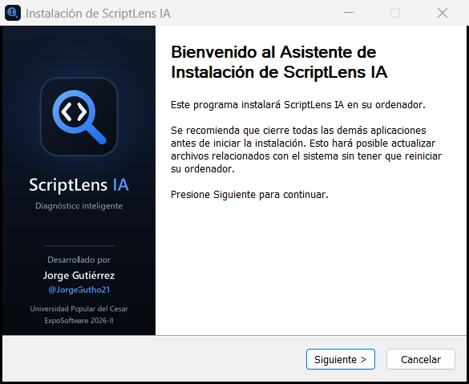
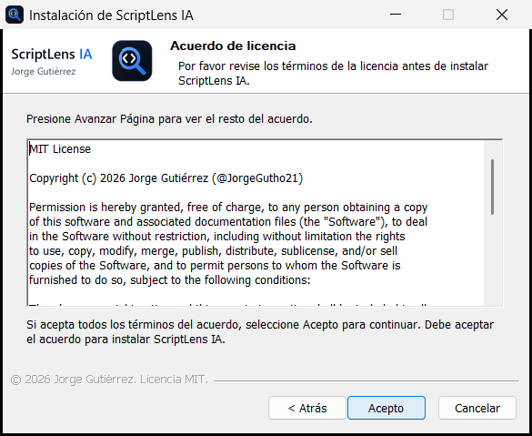
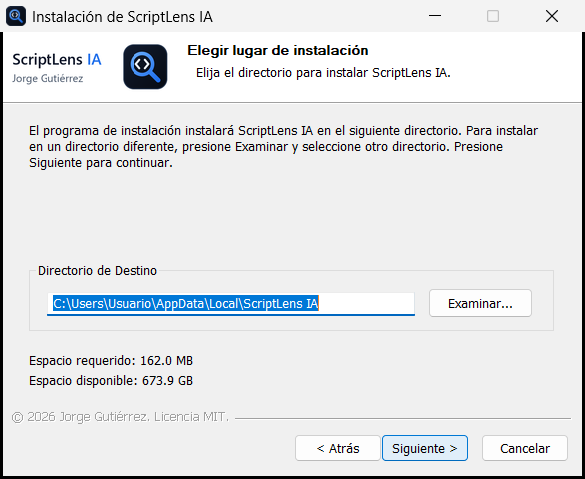
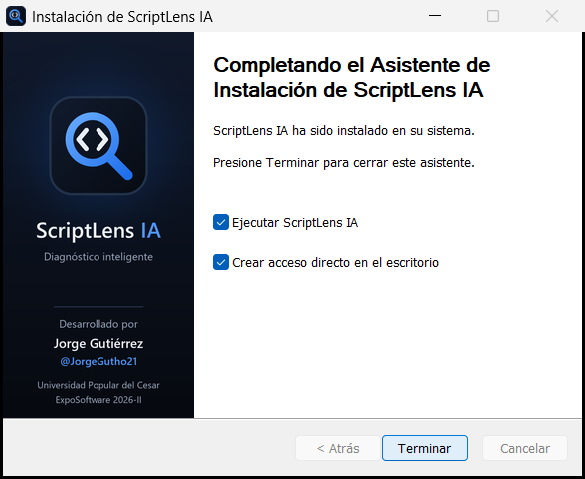

# Guía de instalación de ScriptLens IA

Esta guía distingue siempre **dónde** se realiza cada paso: navegador, Explorador de archivos, PowerShell o terminal del editor.

> La guía completa para principiantes, con todas las capturas, está en [Guia_Instalacion_ScriptLens_IA.pdf](Guia_Instalacion_ScriptLens_IA.pdf).

## Requisitos mínimos

| Elemento | Mínimo | Recomendado |
|---|---|---|
| Sistema | Windows 10 de 64 bits (1809 o posterior) | Windows 11 |
| Memoria RAM | 4 GB | 8 GB o más si usará la IA local |
| Disco | 200 MB | 3 GB si descarga el modelo de IA |
| Componentes | Microsoft Edge WebView2 (incluido en Windows 11) | — |
| Permisos | Cuenta de usuario normal (no requiere administrador) | — |

## Método A — Instalación gráfica (para principiantes)

1. **Navegador:** entre a <https://github.com/JorgeGutho21/ScriptLens> y pulse **Releases** en la columna derecha. Abra la versión marcada como **Latest**.
2. **Navegador:** en la versión más reciente, en «Assets», descargue `ScriptLens-IA_0.1.1_x64-setup.exe` y `ScriptLens-IA_0.1.1_x64-setup.exe.sha256`.
3. **Verifique la procedencia:** la página debe pertenecer a `github.com/JorgeGutho21/ScriptLens`. Para comprobar que el archivo no fue alterado, siga el Método B (pasos 1–3).
4. **Explorador de archivos:** haga doble clic en el instalador. Se abrirá el asistente de instalación (Figura 1).

   

5. Si aparece **«Windows protegió su PC»** (SmartScreen), no omita automáticamente la advertencia. Compruebe el origen, la versión, el hash y las notas de seguridad. Un archivo sin firma puede generar avisos, pero también es necesario investigar cualquier alerta de seguridad real.
6. Pulse **Siguiente**, lea la licencia MIT y pulse **Acepto** (Figura 2). Si el programa ya estaba instalado, deje marcada «Añadir o reinstalar componentes» y pulse **Siguiente**. En la carpeta propuesta, `%LOCALAPPDATA%\ScriptLens IA`, pulse **Siguiente** (Figura 3): la instalación empieza y, al terminar, pulse **Siguiente** y después **Terminar** (Figura 4). Se crea un acceso en el menú Inicio y, si deja marcada la casilla, otro en el escritorio.

   

   

   
7. Abra **ScriptLens IA** desde el menú Inicio. La primera vez el motor puede tardar hasta 30 segundos en iniciar mientras Microsoft Defender examina los archivos nuevos; las siguientes veces tarda unos 10 segundos.
8. Se mostrará el asistente de primera ejecución (ocho pasos) que explica qué analiza la aplicación y qué datos permanecen en el equipo.

## Método B — Descarga verificada con PowerShell

Todos los comandos se ejecutan en **Windows PowerShell** o **PowerShell 7**, sin privilegios de administrador.

1. Abra PowerShell en la carpeta donde descargó los dos archivos (Explorador → clic derecho en un espacio vacío → «Abrir en Terminal»).
2. Calcule el hash del instalador:

   ```powershell
   Get-FileHash ".\ScriptLens-IA_0.1.1_x64-setup.exe" -Algorithm SHA256
   ```

3. Compárelo con el valor publicado y ejecute el instalador solo si coincide:

   ```powershell
   $archivo  = "ScriptLens-IA_0.1.1_x64-setup.exe"
   $esperado = (Get-Content "$archivo.sha256").Split(" ")[0]
   $real     = (Get-FileHash $archivo -Algorithm SHA256).Hash
   if ($real -eq $esperado) { Start-Process ".\$archivo" } else { Write-Error "El hash no coincide: no instale este archivo." }
   ```

4. Instalación silenciosa (opcional, para administradores de aula): `Start-Process ".\$archivo" -ArgumentList '/S' -Wait`.

No se usan comandos de «descargar y ejecutar» scripts remotos. Todavía no existe un paquete oficial de WinGet para ScriptLens IA; cuando se publique, su identificador se documentará aquí.

## Método C — Desarrolladores (desde el código fuente)

| Paso | Dónde | Comando |
|---|---|---|
| Instalar Git | PowerShell | `winget install --id Git.Git -e` |
| Instalar Python 3.12 | PowerShell | `winget install --id Python.Python.3.12 -e --scope user` |
| Instalar Node.js LTS | PowerShell | `winget install --id OpenJS.NodeJS.LTS -e` |
| Instalar Rust | PowerShell | `winget install --id Rustlang.Rustup -e` y luego `rustup default stable` |
| Instalar compilador C++ | PowerShell (pide administrador) | `winget install --id Microsoft.VisualStudio.2022.BuildTools -e --override "--wait --passive --add Microsoft.VisualStudio.Workload.VCTools --includeRecommended"` |
| Clonar el repositorio | PowerShell, en la carpeta deseada | `git clone https://github.com/JorgeGutho21/ScriptLens.git` |
| Entrar en la carpeta | PowerShell | `cd ScriptLens` |
| Entorno de Python | PowerShell | `py -3.12 -m venv .venv` |
| Dependencias del motor | PowerShell | `.\.venv\Scripts\pip install -r backend\requirements-dev.txt pyinstaller` |
| Dependencias de la interfaz | PowerShell | `npm install` y `npm --prefix frontend install` |
| Ejecutar en desarrollo | PowerShell o terminal del editor | `npm run dev` |
| Pruebas | PowerShell | `.\.venv\Scripts\python -m pytest` |
| Reentrenar el clasificador | PowerShell | `.\.venv\Scripts\python -m backend.scripts.train` |
| Construir el instalador | PowerShell | `.\scripts\construir_instalador.ps1` |

Tras abrir una terminal nueva después de instalar herramientas, `python`, `node` y `cargo` quedan disponibles.

## Errores habituales

| Síntoma | Causa | Solución |
|---|---|---|
| `python` abre la Microsoft Store | Alias de ejecución de Windows | Use `py -3.12` o la ruta `%LOCALAPPDATA%\Programs\Python\Python312\python.exe`, o desactive el alias en Configuración → Aplicaciones → Configuración avanzada → Alias de ejecución |
| `linker 'link.exe' not found` | Build Tools no registradas en la sesión | Ejecute `. .\scripts\msvc-env.ps1` en la misma ventana |
| `Get-AuthenticodeSignature` no se reconoce | PowerShell 5.1 hereda módulos de PowerShell 7 | Corregido en ScriptLens (no hereda `PSModulePath`); en consola propia abra «Windows PowerShell» |
| SmartScreen bloquea el instalador | Posible falta de firma o advertencia de reputación | Verifique la procedencia, hash y alertas de seguridad; no omita la protección sin comprender el aviso |
| La ventana muestra «Iniciando el motor de análisis…» más de 30 s | Primer arranque analizado por el antivirus | Espere; si persiste, cierre y vuelva a abrir |
| El asistente responde «sin IA» | Ollama no está abierto o el modelo no está descargado | Abra Ollama y descargue el modelo desde la pantalla del asistente |

## Desinstalación

- **Configuración → Aplicaciones → Aplicaciones instaladas → ScriptLens IA → Desinstalar**, o en PowerShell: `& "$env:LOCALAPPDATA\ScriptLens IA\uninstall.exe"`.
- La desinstalación elimina el programa, los accesos directos y la entrada del registro; conserva sus diagnósticos e informes, salvo que marque en el desinstalador la casilla «Eliminar los datos de aplicación» (borra el historial, no los informes). Para borrarlos, elimine `%LOCALAPPDATA%\io.github.jorgegutho21.scriptlens` y `Documentos\ScriptLens IA`.

## Actualizaciones

En **Acerca de → Buscar actualizaciones** ScriptLens consulta GitHub Releases solo cuando usted lo pide. Si hay una versión nueva, abre la página oficial; la descarga y la instalación las realiza usted, verificando el SHA-256.
